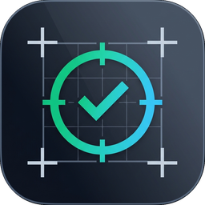
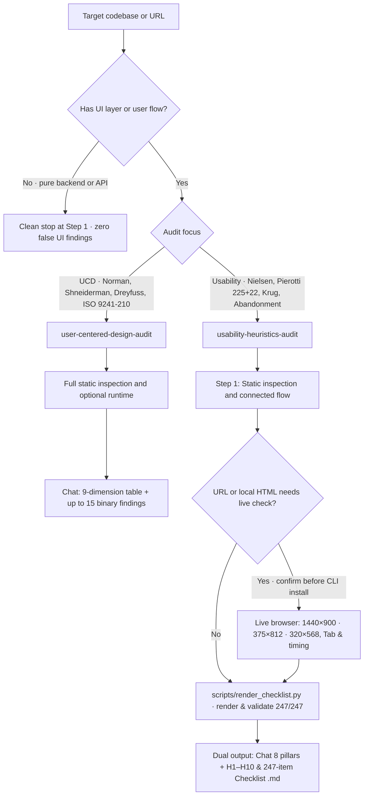
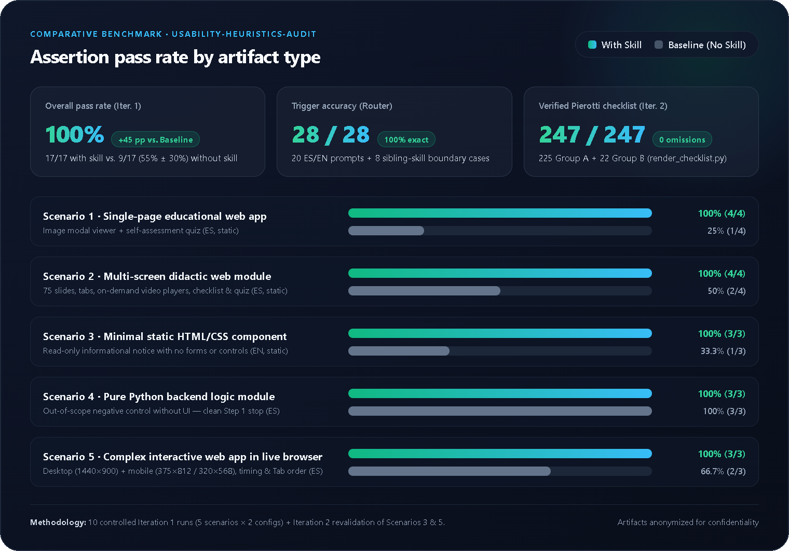

<!-- prettier-ignore -->
<div align="center">



# UX & Usability Audit Skills

_Open agent skills for User-Centered Design (UCD) and Usability Heuristics audits grounded in verifiable technical evidence._

[](#included-skills)
[](#installation)
[](#included-skills)
[-10B981?style=flat-square)](#benchmark-usability-heuristics-audit)
<br />
[](#validation-and-trigger-accuracy)
[](./usability-heuristics-audit/scripts/render_checklist.py)
[](#architecture-and-routing)

[Included Skills](#included-skills) • [Architecture](#architecture-and-routing) • [Installation](#installation) • [Benchmark](#benchmark-usability-heuristics-audit) • [Validation](#validation-and-trigger-accuracy)

</div>

This repository provides two complementary skills compatible with the [`skills`](https://skills.sh/) CLI (`npx skills add`) to audit HTML/CSS/JS, React, Vue, and Flutter frontends. Every reported issue requires direct evidence (`file:line` or observed live browser telemetry) and closes with a **binary technical acceptance criterion** ready for QA or automated E2E testing.

```bash
npx skills add dacastro125/skills -g -y
```

> [!NOTE]
> Both skills perform **read-only** diagnostics: they inspect source code and runtime behavior without modifying target project files unless the user explicitly asks afterward.

---

## Included Skills

| Skill | Theoretical Frameworks Covered | Operational Scope | Default Deliverable |
| --- | --- | --- | --- |
| [**`user-centered-design-audit`**](./user-centered-design-audit/) | **ISO 9241-210**, **ISO 9241-11**, **Don Norman** (mental models, affordances, signifiers, natural mapping, immediate feedback, creeping featurism), **Ben Shneiderman** (direct manipulation), and **Henry Dreyfuss** (ergonomics & error prevention). | **9 closed rubric dimensions** in [clase-1-rubric.md](./user-centered-design-audit/references/clase-1-rubric.md) scored strictly with 5 states (`Pass` / `Partial` / `Fail` / `Not applicable` / `Not statically verifiable`). | Chat report with inferred context, 9-dimension compliance table, and up to **15 prioritized findings** (`Critical` → `High` → `Medium`). |
| [**`usability-heuristics-audit`**](./usability-heuristics-audit/) | **Jakob Nielsen** (`H1–H10` + 5 attributes), **Jakob's Law**, **Deniese Pierotti** (292-ID Xerox taxonomy), **Shneiderman** (8 Golden Rules), **Steve Krug**, **Janice Redish**, **Quesenbery** (`5 Es`), **Preece**, **ISO 9241-11 / 9126**, and **4 web abandonment causes**. | **8 consolidated pillars** + **247 Pierotti items** (`225` active Group A + `22` conditional Group B) backed by [`render_checklist.py`](./usability-heuristics-audit/scripts/render_checklist.py) using Python 3 stdlib only. | **Synced dual deliverable:** prioritized summary by pillars and `H1–H10` in chat + project-root `.md` checklist evaluating all **247 items** 1-by-1. |

<details>
<summary><strong>Technical breakdown of dimensions, pillars, and Pierotti taxonomy (292 IDs)</strong></summary>

- **`user-centered-design-audit` ([`clase-1-rubric.md`](./user-centered-design-audit/references/clase-1-rubric.md)):**
  - *Group A — Design & Interaction:* Mental Models (`#1`), Affordances/Signifiers/Mapping/Feedback (`#2`), Direct Manipulation & Reversible Control (`#3`), Physical/Touch Ergonomics & Error Prevention (`#4`), Avoid Creeping Featurism (`#5`).
  - *Group B — Code, Architecture & QA:* Real User & Environment Adaptation (`#6`, ISO 9241-210 P01), Complete Experience Beyond Happy Path (`#7`, P05), Measurable Usability & Binary Criteria (`#8`, ISO 9241-11), Decoupled Iteration Over DB/API Convenience (`#9`, P04).
- **`usability-heuristics-audit` ([`frameworks-rubric.md`](./usability-heuristics-audit/references/frameworks-rubric.md) · [`pierotti-225-checklist.md`](./usability-heuristics-audit/references/pierotti-225-checklist.md)):**
  - *8 Operational Pillars:* `(1)` Visible Status & Timely Feedback · `(2)` Human Language, Natural Order & Clarity · `(3)` User Control, Reversibility & Exits · `(4)` Consistency, Conventions & Clear Clickables · `(5)` Error Prevention & Resilient Forms · `(6)` Human Error Diagnosis & Recovery · `(7)` Recognition, Minimalism & Hierarchy · `(8)` Efficiency, Operational Accessibility & Contextual Help.
  - *Exact Pierotti coverage (`292` IDs):* `225` **Group A** rules (UI/code inspection) + `22` **Group B** conditional latency, documentation, and runtime rules (`1.17–1.24`, `3.23`, `4.3`, `10.10–10.18`, `11.3`, `11.4`, `11.9`) = **`247` evaluated items**. The `45` **Group C** items requiring user surveys, human lab studies, or organizational audits are explicitly inventoried and excluded to prevent speculation.

</details>

---

## Architecture and Routing



> [!IMPORTANT]
> **Anti-hallucination guard:** whenever a rule depends on runtime visuals, domain terminology outside code, or human user testing without observable evidence, the skill explicitly marks `Not statically verifiable` (or `Not applicable`) instead of guessing.

---

## Installation

Requires **Node.js / `npx`** to manage skills and **Python 3** (standard library only) when running [`render_checklist.py`](./usability-heuristics-audit/scripts/render_checklist.py).

```bash
# Install both skills globally (non-interactive)
npx skills add dacastro125/skills -g -y

# Install selectively
npx skills add dacastro125/skills@usability-heuristics-audit -g -y
npx skills add dacastro125/skills@user-centered-design-audit -g -y
```

> [!TIP]
> Omit `-g` to install only inside the current workspace (e.g., `npx skills add dacastro125/skills@usability-heuristics-audit`). Preview detected skills beforehand with `npx skills add dacastro125/skills --list`.

---

## Benchmark: `usability-heuristics-audit`

<div align="center">
  
</div>

Controlled evaluation across **10 Iteration 1 runs** (5 scenarios × 2 configurations: agent equipped with **`usability-heuristics-audit`** vs. **Baseline** agent without the skill). For confidentiality of the evaluated material, only the **category/type of inspected artifact** is shown.

### Aggregate Summary (Iteration 1)

| Metric | With Skill (`usability-heuristics-audit`) | Baseline (No Skill) | Delta |
| --- | --- | --- | --- |
| **Assertion pass rate** | **`100% ± 0%` (`17/17`)** | `55% ± 30%` (`9/17`) | **`+45 pp` (`+0.45`)** |
| **Mean duration per audit** | `810.6s ± 784.6s` *(`478.8s` on Scen. 1–4)* | `269.8s ± 241.0s` | `+540.8s` |
| **Mean output size** *(character proxy)* | `85,918 ± 50,883` chars | `46,935 ± 41,761` chars | `+38,984` chars |

> [!NOTE]
> In Iteration 1, Scenario 5 with the skill (`2,138s`) hit a ~19-minute hang on an async browser `--stdin` pipe; excluding that technical stall, mean duration across Scenarios 1–4 was `478.8s`. Output size is reported in generated characters because subagents do not expose raw API token counters.

### Breakdown by Artifact Type

| Scenario | Inspected Artifact Type | With Skill | Baseline | Key Behavioral Difference |
| --- | --- | --- | --- | --- |
| **1** | **Single-page educational web app** with image modal viewer and self-assessment quiz (`ES`, static) | **`4/4` (`100%`)** · `663s` | `1/4` (`25%`) · `298s` | With skill delivered `247/247` canonical IDs, 8 pillars, `H1–H10`, and 12 findings with binary criteria. Baseline invented `116` custom items (`P-VIS-*`), skipped pillars, and lacked verifiable criteria. |
| **2** | **Multi-screen didactic web module** with 75 slides, tabs, on-demand video players, checklist, and quiz (`ES`, static) | **`4/4` (`100%`)** · `746s` | `2/4` (`50%`) · `243s` | With skill evaluated `247/247` items, separating `81 Not applicable` and `7 Not statically verifiable`. Baseline admitted lacking the 225-point list and wrote a summary matrix (`0/247` canonical IDs). |
| **3** | **Minimal static HTML/CSS component** rendering a read-only notice with no forms or interactive controls (`EN`, static) | **`3/3` (`100%`)** · `415s` | `1/3` (`33.3%`) · `93s` | With skill applied `227 Not applicable` without false positives, flagged 2 real date-clarity issues, and generated the full checklist in English. Baseline omitted the `225 + 22` `.md` checklist file. |
| **4** | **Pure Python backend logic module** with no UI layer (`ES`, negative out-of-scope control) | **`3/3` (`100%`)** · `91s` | `3/3` (`100%`) · `54s` | With skill detected the scope boundary at Step 1 and stopped cleanly with zero fabricated UI findings or checklist files. Baseline marked N/A for UI while adding unrequested backend contract notes. |
| **5** | **Complex interactive web app in live browser** (`1440×900` desktop and `375×812` / `320×568` mobile, `ES`) | **`3/3` (`100%`)** · `2,138s`* | `2/3` (`66.7%`) · `661s` | With skill completed static inspection first, measured live timings (`Pierotti 1.17–1.24`: `DCL 29 ms`, `load 48 ms`, clicks `0.1–7.4 ms`), `Tab` sequence, and `247/247` items. Baseline launched the browser before reading static code and skipped the checklist. |

---

## Validation and Trigger Accuracy

<details open>
<summary><strong>1. Router & description trigger accuracy: <code>28 / 28 (100%)</code></strong></summary>

- **20 realistic prompts (`ES` / `EN`):** `10` positive usability/heuristics/abandonment audit requests + `10` near-miss negatives (pure backend logic, Norman/Shneiderman/ISO 9241-210 UCD, visual restyling, functional E2E tests).
- **8 ambiguous boundary prompts across sibling skills:** exact routing without collisions against `user-centered-design-audit`, `impeccable`, and `web-design-guidelines`.

</details>

<details open>
<summary><strong>2. Iteration 2 revalidation (post-improvement pass)</strong></summary>

After adding [`scripts/render_checklist.py`](./usability-heuristics-audit/scripts/render_checklist.py), switching async `--stdin` piping to synchronous `eval -b` calls, and adding explicit **`320px` viewport checks** (including clipped descendants inside `overflow: hidden` containers), **Scenarios 3 (`EN` static) and 5 (`ES` live browser)** were re-run:

- Both completed with zero hangs and passed `render_checklist.py validate` (`total_rows=247`, `unique=247/247`, `missing=0`, `dups=0`).
- In Scenario 5, the `320px` check uncovered hidden horizontal clipping under `overflow: hidden`, a non-working tab, a mobile menu focus trap, and keyboard focus leaks.

</details>
